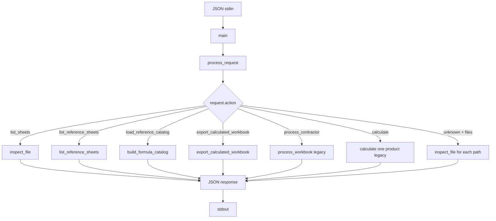
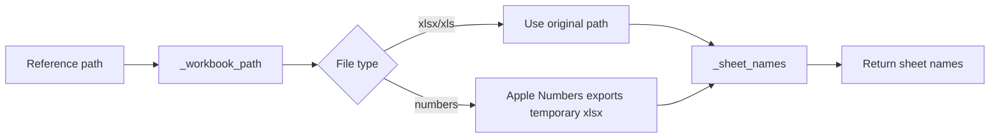
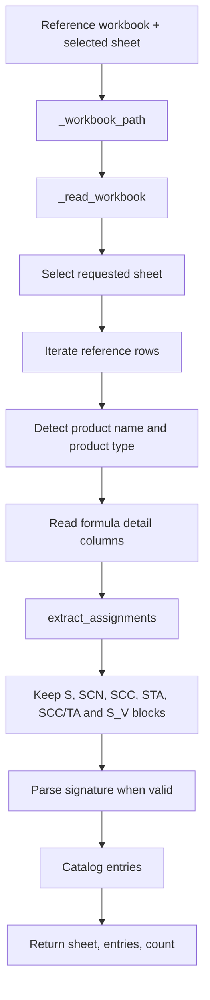
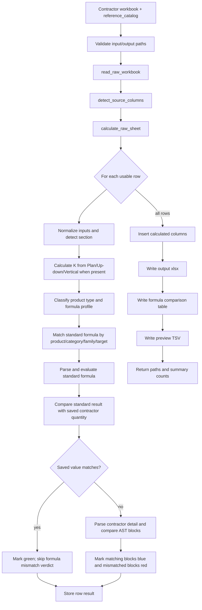
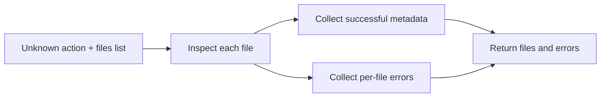

# CONINCO Excel Auditor

Offline desktop application for checking contractor Excel workbooks against a
standard formula workbook.

The application has two separate inputs:

1. A **formula reference workbook**. It contains product names, product types,
   formula labels and standard formula blocks. The application reads this file
   as the calculation authority; it does not calculate the reference workbook.
2. A **contractor workbook**. It contains the rows to process. The application
   classifies each row, maps it to the standard catalog, calculates the result,
   compares it with the contractor's saved quantity, and exports a new workbook.

The application runs locally. Workbooks and the formula catalog are not sent to
an external service.

## Main workflow

```text
Choose reference workbook
        |
        v
Choose reference sheet
        |
        v
Read formula descriptions -> build formula catalog -> cache formula-catalog.json
        |
        v
Choose contractor workbook -> choose contractor sheet
        |
        v
Classify product and formula family
        |
        v
Map inputs to the standard formula catalog
        |
        v
Calculate K/S/SCN/SCC/STA using the standard formula
        |
        v
Compare saved workbook values
        |
        +--> matching value: green; formula text is not checked
        |
        +--> different value: compare contractor formula blocks and AST
        |
        v
Export calculated workbook + comparison preview + local archive entry
```

## Python engine workflows (`excel_engine.main`)

The Python sidecar receives one JSON object from stdin, dispatches it by
`request.action`, and returns one JSON object on stdout. The desktop app uses
the `export_calculated_workbook` branch for **Run Audit**.

### 1. Request dispatch



Every branch converts expected input errors into the common response shape:
`ok`, `result` or `files`, and `errors`.

### 2. Inspect contractor workbook sheets: `list_sheets`

```mermaid
flowchart LR
    A[Path from request] --> B[Path.expanduser().resolve]
    B --> C[read_workbook]
    C --> D[Read all worksheets]
    D --> E[Collect name, rows, columns, column_names]
    E --> F[Return workbook metadata]
```

This workflow only inspects the workbook structure. It does not calculate
quantities or compare formulas.

### 3. List reference sheets: `list_reference_sheets`



The temporary `.xlsx` created for a `.numbers` file is deleted when the
workflow finishes.

### 4. Build the formula catalog: `load_reference_catalog`



The catalog is the authority for Run Audit. This workflow reads formula
descriptions; it does not calculate the reference workbook.

### 5. Run Audit: `export_calculated_workbook`



Important authority rule:

```text
reference catalog -> standard formula -> standard calculation -> output file
contractor formula -> row classification and mismatch explanation only
```

Rows without enough product or geometry input are skipped. A shared
`SCC/TA` formula is evaluated once and its result is copied to both SCC and
STA output columns when those columns are separate.

### 6. Legacy direct calculation workflows

These branches remain available for compatibility but are not used by the
desktop **Run Audit** button.

#### `process_contractor`


#### `calculate`


#### Unknown action with `files`



## User interface

The desktop application contains four pages:

- **Process**: select the reference workbook and sheet, select the contractor
  workbook and sheet, then run the audit.
- **Formula catalog**: view product name, product type, category, target and
  readable standard formula blocks. The page can export the catalog as JSON.
- **Archive**: list previous audits, open or download submitted/processed
  workbooks, and remove an archived audit.
- **Comparison**: inspect calculated rows and formula errors. The original
  contractor formula and standard formula are shown side by side. AST errors
  are shown at the smallest differing branch when available.

## Formula authority and mapping rules

The contractor formula is not the calculation authority. It is used for row
classification and, only when the saved quantity differs from the standard
result, for an explanatory formula comparison.

### Product mapping

The product description is mapped to a product type such as:

- `rectangular_duct`
- `round_duct`
- `elbow`
- `square_elbow`
- `reducer`
- `square_round_reducer`
- `tee`
- `takeoff`
- `end_cap`
- `mfd_valve`
- `nrd_valve`

The input columns are detected from workbook headers. The legacy Sheet 02
layout remains supported, while named `SCN`, `SCC` and `STA` quantity columns
are detected when present.

### Formula-family mapping

- `S` or `SCN`: outside insulation quantity.
- `SCC`: fireproof quantity.
- `STA`: acoustic/inside quantity.
- `SCC/TA`: one shared fireproof/acoustic formula. Its result is written once
  and copied to both corresponding inside quantity outputs when the workbook
  has separate columns.
- `S_V1`, `S_V2`, `S_V3`, `S_V4`: intermediate blocks. They are compared as
  separate blocks when the reference formula defines them.
- Fire damper/MFD rows whose variants say the inside quantity is included in the
  valve use the SCN formula shape only as the special family signal described
  in the parser; ordinary rows are mapped by their labels.

### K calculation

If any of `Plan`, `Up-down` or `Vertical axis` has a value, `K` is calculated
from those components. If all three are empty, the workbook's K value is used
as the input to the standard formula.

### Value-first comparison

The saved quantity is the primary verdict. Values are compared at the displayed
three-decimal precision with normal rounding tolerance:

- matching result: the output remains green and formula text is not used to
  turn it red;
- different result: the original formula, standard formula and formula blocks
  are compared;
- missing or malformed formula text is displayed as diagnostic information and
  does not stop other rows from being processed.

For a mismatch, the comparison uses parsed ASTs. Variable aliases such as
`G12` and `W''` are normalized to the same logical dimension before comparison.
Commutative addition/multiplication and equivalent linear grouping are
normalized, while meaningful differences such as `R / 2 ^ 2` versus
`(R / 2) ^ 2` remain visible.

The UI uses only the formula comparison colors requested by the audit flow:

- dark blue: matched formula block;
- light red: mismatched formula block;
- dark red, bold and underlined: exact AST fragment that differs.

## Reference workbook persistence

When a reference workbook is saved, the Tauri layer copies it into the
application data directory and records a small manifest. The parsed catalog is
cached at:

```text
<application-data>/formula-reference/formula-catalog.json
```

The cache is keyed by the stored reference path and selected sheet. The app can
reuse the catalog if the original reference file is later removed. Selecting a
new reference workbook or using **Remove saved reference file** invalidates the
old catalog. The Formula catalog page also has an **Export JSON** button for a
portable copy.

The exact application-data directory is platform-specific:

- macOS: the Tauri app data directory for `com.coninco.excelauditor`;
- Windows: the app data directory selected by Tauri for the same identifier.

## Input and output files

Supported input formats:

- contractor workbook: `.xlsx`, `.xls`;
- reference workbook: `.xlsx`, `.xls`, `.numbers` on macOS when Apple
  Numbers/`osascript` is available.

The exported contractor workbook is always `.xlsx`. The exporter:

- preserves original rows, worksheets, merged cells, dimensions and styles;
- keeps the original workbook as the submitted archive file;
- adds calculated columns beside K and the detected S/SCN/SCC/STA columns;
- writes the standard formula result, not the contractor formula result;
- writes a tab-separated comparison preview next to the processed workbook.

The Tauri archive stores the submitted workbook, processed workbook, sheet,
row count, mismatch count and creation time in local SQLite.

## Repository structure

```text
.
├── README.md                         # Project overview and operating guide
├── .gitignore
├── docs/
│   ├── architecture.md               # Runtime architecture
│   ├── development-guide.md          # Short developer setup guide
│   └── task-roadmap.md               # Historical implementation roadmap
├── desktop-app/                      # Active React + Tauri application
│   ├── package.json                  # npm scripts and dependencies
│   ├── package-lock.json
│   ├── index.html
│   ├── public/coninco-logo.png
│   ├── scripts/
│   │   ├── build-engine.sh           # macOS/Linux PyInstaller build
│   │   └── build-engine.ps1          # Windows PyInstaller build
│   ├── src/
│   │   ├── App.tsx                   # Process, Catalog, Archive, Comparison UI
│   │   ├── index.css                 # Global styles and Tailwind layers
│   │   ├── main.tsx                  # React entry point
│   │   ├── types.ts                  # UI/API types
│   │   └── lib/engine.ts             # Tauri commands and demo adapters
│   └── src-tauri/
│       ├── Cargo.toml                # Rust/Tauri dependencies
│       ├── src/main.rs               # Native commands, archive, sidecar bridge
│       ├── tauri.conf.json           # Window, bundle and resource config
│       ├── icons/                    # Application icons
│       └── engine/                   # Generated PyInstaller sidecar
├── python-engine/                    # Active local calculation engine
│   ├── requirements.txt
│   ├── engine_entry.py               # PyInstaller entry point
│   ├── src/excel_engine/
│   │   ├── main.py                   # JSON stdin/stdout process contract
│   │   ├── excel_reader.py            # .xlsx/.xls reader boundary
│   │   ├── input_formats.py           # Header and quantity-column detection
│   │   ├── product_formatter.py       # Product classification and inputs
│   │   ├── formula_parser.py           # Normalize, tokenize, parse and evaluate
│   │   ├── formula_catalog.py          # Reference formula extraction/matching
│   │   ├── workbook_report.py          # Audit, AST compare and Excel export
│   │   ├── quantity_calculator.py      # K component calculation
│   │   ├── test.ipynb                 # Parser/debug walkthrough notebook
│   │   └── README.md                  # Package-level export notes
│   └── tests/                         # Unit and integration-style tests
├── target/                            # Local PyInstaller work/spec output
└── Coninco_excel_desktop/             # Legacy duplicate snapshot
```

`desktop-app/` and `python-engine/` at the repository root are the active
source directories. `Coninco_excel_desktop/` is kept as a historical duplicate
from an earlier project layout; do not use it for current builds unless the
files are intentionally synchronized.

Generated or machine-local files are ignored, including `node_modules`, Vite
output, Tauri targets, Python virtual environments, PyInstaller binaries and
workbook fixtures under `python-engine/src/excel_engine/`.

## Development setup

### 1. Python engine

```bash
python3 -m venv python-engine/.venv
python-engine/.venv/bin/python -m pip install -r python-engine/requirements.txt
```

The engine uses pandas, openpyxl and xlrd for workbook processing. Legacy `.xls`
export requires LibreOffice (`soffice`) at runtime; the packaged sidecar
includes the Python dependencies but cannot provide a platform Excel converter
when the operating system does not have one.

### 2. React/Tauri application

```bash
cd desktop-app
npm install
```

Rust and the Tauri native prerequisites are required for the desktop shell.
Node/npm is enough for the browser UI preview.

## Run and build

From `desktop-app/`:

```bash
# Browser preview with demo data
npm run dev

# Native development app; uses python-engine/.venv when available
npm run tauri:dev

# TypeScript check and Vite production build
npm run build

# Build the Python sidecar first, then package the desktop app
cd ..
./desktop-app/scripts/build-engine.sh
cd desktop-app
npm run tauri:build
```

Production macOS artifacts are written under:

```text
desktop-app/src-tauri/target/release/bundle/macos/
desktop-app/src-tauri/target/release/bundle/dmg/
```

Windows packages must be built on Windows:

```powershell
cd desktop-app
& .\scripts\build-engine.ps1
npm install
npm run tauri:build
```

## Test commands

Run all Python tests from the repository root:

```bash
PYTHONPATH=python-engine/src \
  python-engine/.venv/bin/python \
  -m unittest discover -s python-engine/tests -p 'test_*.py' -v
```

The workbook-report tests use small in-memory workbooks and the local
value-only fixture when available. Tests tied to a personal reference workbook
in `Downloads` are opt-in so a clean clone does not depend on a user's files:

```bash
CONINCO_RUN_EXTERNAL_WORKBOOK_TESTS=1 \
  PYTHONPATH=python-engine/src \
  python-engine/.venv/bin/python \
  -m unittest discover -s python-engine/tests -p 'test_*.py' -v
```

## JSON process contract

The Python engine reads exactly one JSON request from stdin and writes one JSON
response to stdout. The desktop app invokes it through the Tauri Rust bridge.

### Inspect workbook sheets

```json
{"action":"list_sheets","path":"/absolute/path/input.xlsx"}
```

### Inspect reference sheets

```json
{"action":"list_reference_sheets","path":"/absolute/path/reference.xlsx"}
```

### Load the reference catalog

```json
{
  "action": "load_reference_catalog",
  "path": "/absolute/path/reference.xlsx",
  "sheet": "COMBINE"
}
```

The result contains `sheet`, `count` and `entries`. Each entry includes the
product name, `product_type`, category, family, output target, formula text,
complete `formula_block`, source sheet/row and a parsed signature when valid.

### Export an audited workbook

```json
{
  "action": "export_calculated_workbook",
  "path": "/absolute/path/contractor.xls",
  "output": "/absolute/path/contractor_calculated.xlsx",
  "sheet": "02",
  "reference_path": "/absolute/path/reference.xlsx",
  "reference_sheet": "COMBINE"
}
```

`reference_catalog` may be supplied in the request to avoid reading the
reference workbook again. Run Audit always follows this order: require the
catalog, match the standard formula by product/category/family, parse and
evaluate that standard formula, then export the result. The response contains
`calculated_count`,
`mismatch_count`, `reference_formula_count`, `preview`, output paths and any
row-level errors.

An unknown action with a non-empty `files` list falls back to workbook
inspection for backward compatibility.

## Formula parser pipeline

The parser handles contractor and reference formula descriptions in these
stages:

1. `_normalize_source`: converts Unicode multiplication/division/minus signs,
   decimal separators and implicit `x` multiplication into parser syntax.
2. `extract_assignments`: extracts labelled blocks such as `S`, `SCN`, `SCC`,
   `STA`, `SCC/TA` and `S_V1`.
3. `_tokens`: converts an expression into numbers, names, operators,
   parentheses, cell references and function calls.
4. `parse_formula`: builds the AST while preserving Excel precedence, including
   the important difference between `R / 2 ^ 2` and `(R / 2) ^ 2`.
5. `formula_block_result`: resolves intermediate assignments and evaluates one
   explicit output target.
6. `canonical`: normalizes aliases, commutative order and equivalent linear
   groupings for structural comparison.
7. `render_excel`: renders the authoritative standard AST back to an Excel
   formula for the calculated result column.

## Troubleshooting

- **No reference worksheet**: choose a formula workbook and select a sheet on
  Process before running an audit.
- **Reference workbook was deleted**: the app can continue from its cached
  catalog if the reference was previously saved. If the cache was removed too,
  select the reference workbook again.
- **`.numbers` cannot be read**: export it to `.xlsx`, or ensure Apple Numbers
  and `osascript` are available on macOS.
- **`.xls` export fails**: install LibreOffice so `soffice` is available.
- **No calculated rows**: check the selected sheet and ensure it has a product
  description plus numeric geometry/input columns.
- **Python sidecar missing in a release build**: run
  `./desktop-app/scripts/build-engine.sh` before `npm run tauri:build`.
- **Formula is shown as unavailable**: the selected reference sheet does not
  have a usable matching standard entry. The saved quantity still controls the
  green/red verdict, and the missing formula is kept as audit metadata.

## Release checklist

```text
[ ] python-engine/.venv exists and requirements are installed
[ ] Python unittest suite passes
[ ] npm run build passes
[ ] build-engine.sh / build-engine.ps1 produces the sidecar
[ ] npm run tauri:build passes on the target operating system
[ ] Reference workbook and selected sheet are tested
[ ] Contractor workbook output opens and preserves the original layout
[ ] Formula catalog JSON export is readable
[ ] Processed workbook and comparison preview are present
[ ] git diff --check is clean
```
